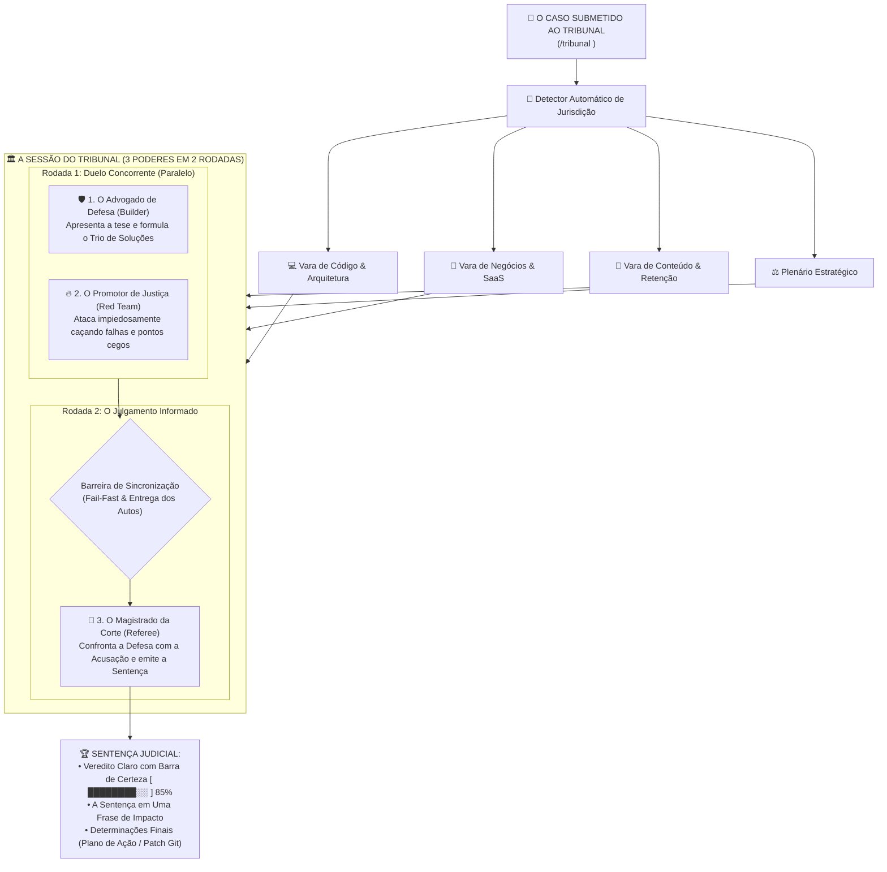

# 🏛️ TRIBUNAL (`/tribunal`)
> **A Primeira Corte Suprema de Inteligência Artificial no seu Terminal.**  
> Elimine a bajulação das IAs. Submeta qualquer código, ideia de negócio, precificação ou roteiro a 3 modelos concorrentes em julgamento dialético real em 2 rodadas.

[](https://skills.sh)
[](LICENSE)
[](#)
[](#)

---

## 🛑 O Problema: Toda IA é Puxa-Saco (Sycophancy)

Quando você pergunta para o ChatGPT, Claude ou Gemini:  
*"O que achou dessa minha ideia?"* ou *"Revise esse meu código"*, a resposta padrão é quase sempre:  
> *"Excelente ideia! Muito bem estruturado, parabéns!"*

**Elas mentem para agradar você.** Um modelo sozinho tem pontos cegos cognitivos e é treinado para ser complacente. No dia seguinte, seu código quebra em produção ou sua campanha zera em vendas.

---

## 🏛️ A Solução: Instanciar uma Corte Implacável em 2 Rodadas

O **Tribunal** não faz elogios. Ele pega o seu caso e instancia **3 modelos em 2 rodadas reais com barreira de sincronização**:



---

## 🚀 Instalação em 1 Clique (Zero Dependências)

Instale direto no seu agente via [skills.sh](https://skills.sh):

```bash
npx skills add Gabrielrtads/tribunal
```

Compatível nativamente com:
- **Google Antigravity** (`agy`)
- **Claude Code** (`claude`)
- **OpenAI Codex** (`codex`)
- **Cursor / Windsurf / Terminal Linux e Windows**

---

## 💬 Como Usar (100% Vibe Coding)

Sem flags chatas. Sem menus de configuração obrigatórios. Basta invocar no chat do seu agente:

### 1. Julgar um Código ou Arquitetura
```text
/tribunal "Criei este webhook de pagamento com retry no Redis. O que vai quebrar?"
/tribunal --diff                       # Julga as alterações recentes do git diff
/tribunal --file src/auth.ts           # Julga um arquivo cirúrgico
```

### 2. Julgar uma Ideia de Negócio / SaaS
```text
/tribunal "Devo cobrar R$ 97/mês no modelo ilimitado ou cobrar por uso no Barber.fi?"
```

### 3. Julgar um Gancho de Conteúdo / Vídeo
```text
/tribunal "Esse título de vídeo no YouTube tá apelativo ou tá genérico?"
```

### 4. Modo "Corte Marcial" (Auditoria Implacável / Hardcore)
Para quando você precisa que o modelo use 100% da sua força bruta de raciocínio:
```text
/tribunal --fogo "Revise a migração do banco de dados de produção antes do deploy"
```

---

## 🛡️ Segurança Absoluta (Zero Write Mutation)

- **100% Read-Only:** O Tribunal roda estritamente em modo `plan`. Ele **não altera nenhum arquivo** do seu projeto sem a sua autorização expressa.
- **Isolamento Concorrente:** Os agentes rodam em paralelo no seu processador, sem conflito de escrita.
- **Fail-Fast:** Se a Defesa ou a Acusação falharem na Rodada 1, a sessão é abortada imediatamente, economizando 100% dos tokens do Magistrado.

---

## 📄 Licença

MIT © [Gabriel Toledo](https://github.com/Gabrielrtads)
